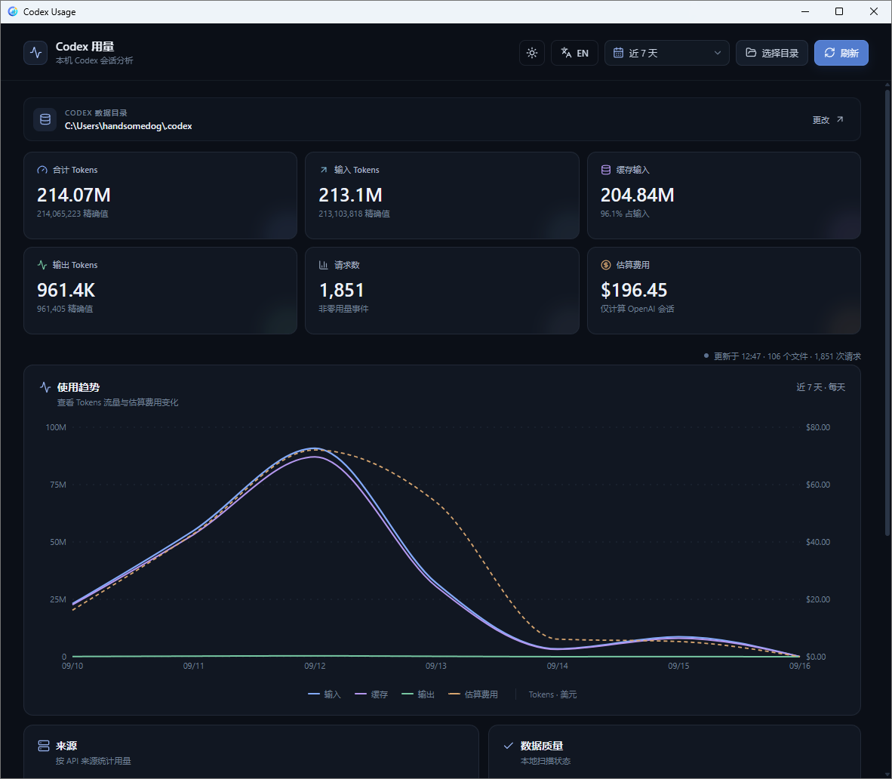
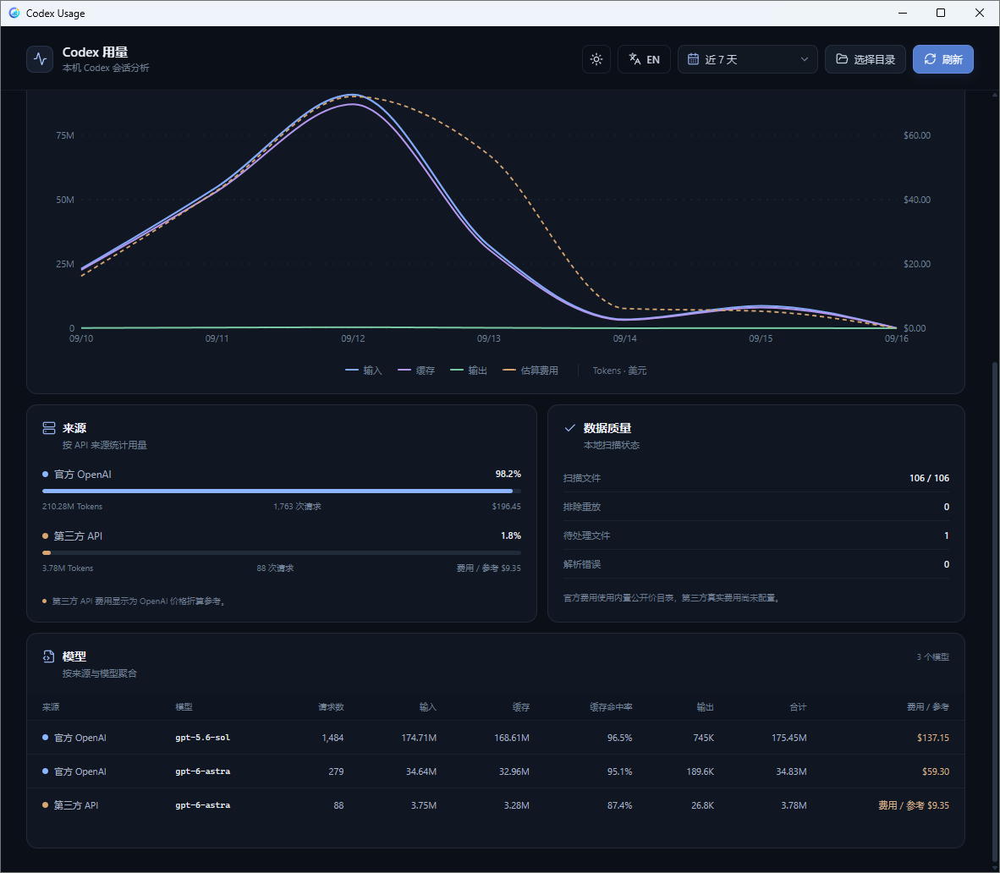

# Codex Usage Monitor

一个基于 **Tauri 2 + React + TypeScript + Rust** 的本地 Codex 用量分析桌面应用。它读取 Codex 保存在本机的会话日志，汇总 Token、请求数、模型、API 来源和估算费用，并通过图表展示用量趋势。

> 所有统计都在本机完成。应用不会将会话日志上传到远程服务。

## 界面预览

顶部汇总 Token、请求数与估算费用，并按小时、天、周或月展示用量趋势：



向下滚动可以看到来源分布、数据质量报告，以及按模型聚合的明细表：



## 功能特性

- **用量概览**：统计总 Token、输入 Token、缓存输入、输出 Token、请求数与估算费用。
- **时间趋势**：按小时、天、周或月展示 Token 与费用变化。
- **灵活时间范围**：支持今天、近 24 小时、近 7 天、近 30 天、本月、全部历史和自定义日期范围。
- **来源与模型分析**：按 API 提供商以及提供商加模型维度聚合用量。
- **缓存分析**：展示缓存输入数量与缓存命中率。
- **数据质量信息**：显示扫描/解析文件数、排除的分叉重放事件、延后处理的文件和解析错误。
- **避免重复统计**：识别重复请求，并处理 fork/subagent 会话中重放的 Token 事件。
- **本地目录切换**：默认读取 `CODEX_HOME`，也可以在界面中选择其他 Codex 数据目录。
- **中英双语**：支持简体中文与 English。
- **明暗主题**：支持亮色、暗色主题并记住用户选择。

## 数据来源

应用会递归扫描 Codex 数据目录中的以下位置：

```text
<CODEX_HOME>/sessions/
<CODEX_HOME>/archived_sessions/
```

只读取文件名符合 `rollout-*.jsonl` 的会话日志，并从其中的 `session_meta`、`turn_context` 和 `token_count` 事件提取统计信息。

Codex 数据目录按以下优先级确定：

1. 环境变量 `CODEX_HOME`；
2. 当前用户主目录下的 `.codex`，例如 Windows 上的 `%USERPROFILE%\.codex`；
3. 通过应用右上角的“选择目录”手动指定。

统计解析器已经编译进 Rust/Tauri 可执行文件：运行时不会加载 `codex_usage.py`，不需要 Python，也不依赖源项目的绝对路径。因此，构建后可以移动应用目录，或重命名其所在文件夹。

## 界面指标说明

| 指标 | 说明 |
| --- | --- |
| 合计 Tokens | 输入 Token + 输出 Token；缓存输入已经包含在输入 Token 中，不会重复相加 |
| 输入 Tokens | 请求使用的全部输入 Token，包括缓存输入 |
| 缓存输入 | 输入 Token 中由缓存命中的部分 |
| 输出 Tokens | 模型生成的输出 Token |
| 请求数 | 包含非零用量的去重 Token 事件数 |
| 估算费用 | 根据内置公开价格表估算的 OpenAI 会话费用 |

### 费用统计说明

费用仅供参考，并不等同于账单金额：

- OpenAI 来源按照 `src-tauri/src/usage.rs` 中的内置模型价格表进行估算；
- 缓存输入、非缓存输入和输出 Token 分别计价；
- 第三方 API 未配置实际价格，界面仅显示按照 OpenAI 同名模型价格折算的参考值；
- 价格表中不存在的模型会显示为未定价；
- 模型价格可能随时间变化，如需精确结果，请更新内置价格表并以服务商实际账单为准。

## 技术栈

- [Tauri 2](https://tauri.app/)：桌面应用容器与本地命令调用
- [Rust](https://www.rust-lang.org/)：扫描、解析和聚合本地会话日志
- [React 18](https://react.dev/)：用户界面
- [TypeScript](https://www.typescriptlang.org/)：前端类型系统
- [Vite 6](https://vite.dev/)：前端开发与构建
- [Recharts](https://recharts.org/)：趋势图表
- [Lucide React](https://lucide.dev/)：界面图标

## 环境要求

开始前请准备：

- [Node.js](https://nodejs.org/) 18 或更高版本，推荐当前 LTS；
- npm；
- [Rust](https://www.rust-lang.org/tools/install) stable 工具链；
- Tauri 2 对应平台的系统依赖。

不同操作系统所需的 WebView、编译工具和系统库有所不同，请参考 [Tauri Prerequisites](https://v2.tauri.app/start/prerequisites/) 完成配置。

### Windows

通常需要：

- Microsoft C++ Build Tools，勾选“使用 C++ 的桌面开发”；
- Microsoft Edge WebView2 Runtime；
- Rust MSVC 工具链。

## 快速开始

### 1. 安装依赖

```powershell
npm install
```

如果需要严格按照锁文件进行可复现安装，可以使用：

```powershell
npm ci
```

### 2. 启动桌面开发模式

```powershell
npm run tauri dev
```

Tauri 会自动启动 Vite 开发服务器，并打开桌面应用窗口。首次编译 Rust 依赖可能需要一些时间。

> 不要只使用 `npm run dev` 体验完整功能。单独启动 Vite 只会打开前端页面，而读取本地会话日志依赖 Tauri 后端。

### 3. 查看用量

1. 应用启动后会解析默认的 `CODEX_HOME`；
2. 如果默认目录不可用，点击“选择目录”并选择包含 `sessions` 或 `archived_sessions` 的 Codex 数据目录；
3. 通过右上角时间范围菜单切换统计周期；
4. 新会话产生后，点击“刷新”重新扫描。

## 构建

### 检查并构建前端

```powershell
npm run build
```

前端产物会生成到 `dist/`。

### 构建桌面应用

```powershell
npm run tauri build
```

Rust 构建产物会生成到 `src-tauri/target/release/`，其中：

- `codex-usage-monitor.exe`：优化后的可执行文件；
- `bundle/nsis/Codex Usage Monitor_0.1.0_x64-setup.exe`：推荐普通用户使用；
- `bundle/msi/Codex Usage Monitor_0.1.0_x64_en-US.msi`：适用于企业批量分发。

产物名称中的版本号取自 `tauri.conf.json` 的 `version` 字段。

### 自动发布

仓库配置了 GitHub Actions 工作流 `.github/workflows/release.yml`：推送形如 `v*` 的 tag 后，会在 Windows runner 上自动编译、打包并创建 GitHub Release。

```powershell
# 先把 tauri.conf.json 里的 version 改成对应版本，例如 0.1.1
git add .
git commit -m "release: v0.1.1"
git push

git tag v0.1.1
git push origin v0.1.1
```

注意 `tauri.conf.json` 里的 `version` 不带 `v` 前缀，而 tag 带。工作流也支持在 Actions 页面手动触发：此时只构建、不创建 Release，安装包从 workflow artifacts 下载，可用于在正式打 tag 前验证打包链路。

### 预览前端构建产物

```powershell
npm run preview
```

该命令仅预览前端静态资源，不提供 Tauri IPC 和本地日志扫描能力。

## 测试

运行 Rust 后端单元测试：

```powershell
cargo test --manifest-path src-tauri/Cargo.toml
```

项目当前未配置前端自动化测试脚本。提交改动前建议至少运行：

```powershell
npm run build
cargo test --manifest-path src-tauri/Cargo.toml
```

## 项目结构

```text
codex-usage-monitor/
├─ src/
│  ├─ App.tsx              # 主界面、交互与 Tauri 命令调用
│  ├─ main.tsx             # React 入口
│  ├─ styles.css           # 全局样式与主题
│  ├─ types.ts             # 用量报告类型定义
│  └─ lib/format.ts        # 数字、百分比与美元格式化
├─ src-tauri/
│  ├─ src/main.rs          # Tauri 入口与命令注册
│  ├─ src/usage.rs         # JSONL 扫描、去重、聚合和费用估算
│  ├─ capabilities/        # Tauri 权限配置
│  ├─ icons/               # 应用图标
│  ├─ Cargo.toml           # Rust 依赖与包配置
│  └─ tauri.conf.json      # 窗口、构建、打包和安全配置
├─ .github/workflows/      # 自动发布工作流（tag 触发）
├─ preview/                # README 界面预览图
├─ index.html
├─ package.json
├─ package-lock.json
├─ vite.config.ts
└─ tsconfig*.json
```

## 统计口径与数据质量

为了尽量避免重复计算，后端会：

- 优先使用 `last_token_usage`，否则通过累计值的差量计算单次用量；
- 忽略没有实际 Token 增量的事件；
- 按会话与事件序号去重请求；
- 识别 fork/subagent 会话继承的父会话历史，并排除已重放的前缀事件；
- 对父会话缺失、元数据不一致或时间戳无效等无法安全判断的文件延后统计；
- 在“数据质量”区域展示扫描结果，便于发现日志格式或数据完整性问题。

时间范围按照本机时区计算。趋势粒度会随范围自动变化：单日按小时、90 天以内按天、730 天以内按周，更长范围按月。

## 隐私与安全

- 会话日志由 Rust 后端直接从本机文件系统读取；
- 前端仅通过 Tauri IPC 调用本地的 `default_codex_home` 和 `analyze_usage` 命令；
- 应用当前未实现遥测、账号登录或日志上传；
- Codex 会话日志可能包含敏感信息，请不要将原始日志或包含私有路径的截图公开分享。

## 已知限制

- 必须通过 Tauri 桌面运行，普通浏览器模式无法扫描本地日志；
- 统计结果依赖 Codex rollout JSONL 的当前数据结构，未来日志格式变化可能需要同步适配；
- 内置价格表只覆盖代码中列出的模型，且不会自动联网更新；
- 第三方 API 的真实费用未知，只能显示 OpenAI 等价参考费用；
- 扫描大型历史目录时耗时取决于日志数量、文件大小和磁盘性能；
- 当前未提供导出 CSV/JSON 或后台自动刷新；
- Windows 安装包未做代码签名，首次安装可能触发 SmartScreen「未知发布者」提示。

## 常见问题

### 提示 `Codex directory not found` 怎么办？

确认选择的是 Codex 数据根目录，而不是某个具体的日期或会话子目录。数据根目录下通常应包含 `sessions/` 或 `archived_sessions/`。

### 为什么费用为 0 或显示未定价？

可能是当前范围只有第三方来源、模型不在内置价格表中，或者日志没有可计价的 Token 事件。可以在“来源与模型”和“数据质量”区域进一步确认。

### 为什么文件数与请求数不同？

一个 rollout 文件可以包含多个请求，也可能没有非零 Token 事件。重复事件和 fork 重放事件还会被排除，因此两者不应简单对应。

### 为什么扫描结果与服务商账单不同？

本项目根据本地日志和内置价格表估算，无法覆盖服务商的折扣、套餐、免费额度、价格调整、第三方计费规则或日志缺失等情况。服务商账单应作为最终依据。

## License

[MIT](LICENSE) © 2026 handsomedogx
